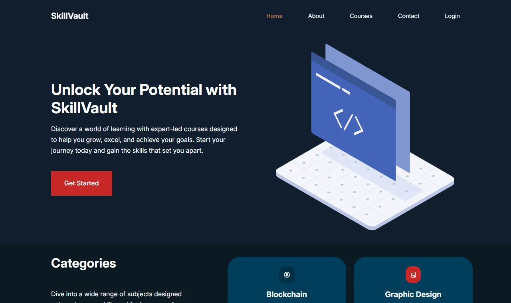
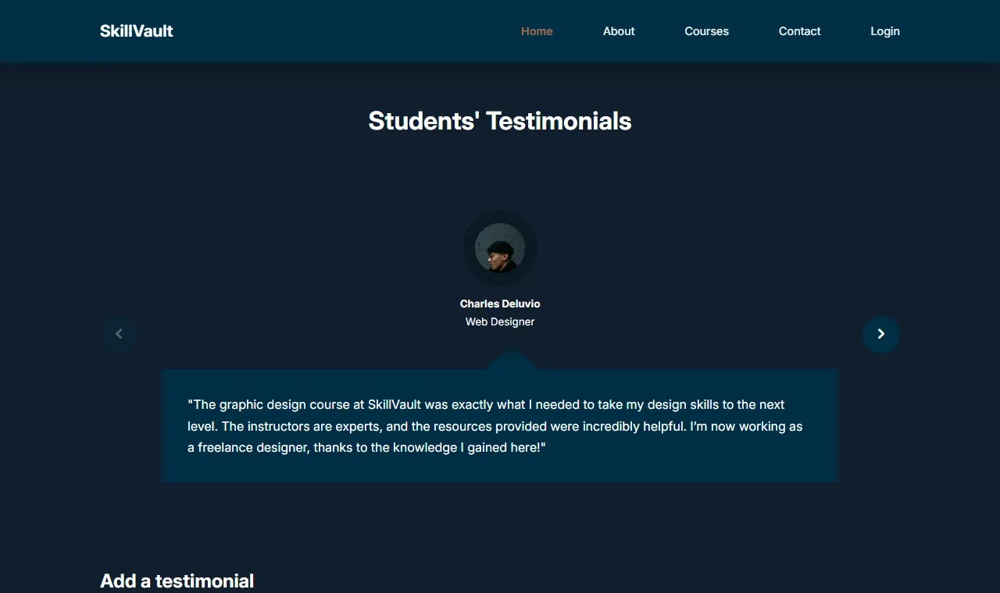
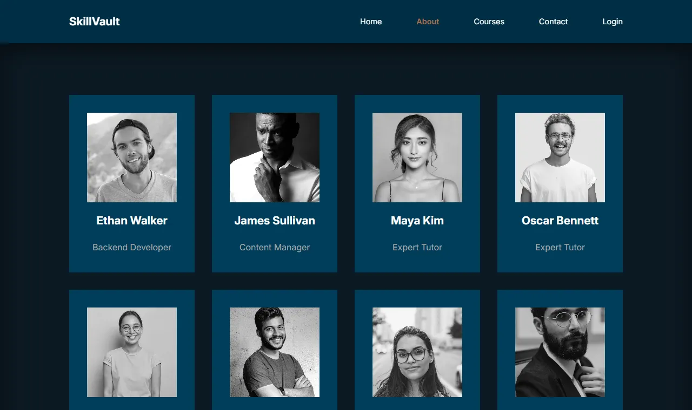
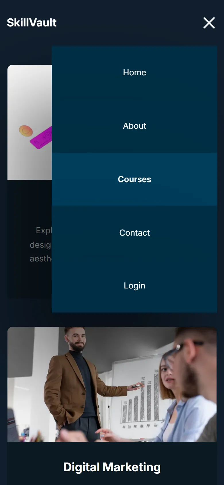

# SkillVault

A responsive, multi-page website for a fictional online learning platform, built as a first-year university project with plain **HTML, CSS and JavaScript**. No frameworks and no installation: open `index.html` and it runs.



## Highlights

- **Fully responsive:** desktop, tablet (≤ 1023px) and mobile (≤ 600px) layouts built with CSS Grid and Flexbox
- **Interactive without a framework:** testimonials slider, FAQ accordion, mobile menu and a contact form that sends without reloading, all in vanilla JavaScript
- **Fast:** every photo is a resized WebP and images below the fold are lazy-loaded. The image folder went from about 70 MB to 1.3 MB, and the About page from a 42 MB download to under 0.5 MB
- **Accessible:** keyboard-friendly FAQ buttons with `aria-expanded`, descriptive alt text, labelled icon links, and visible focus outlines on the FAQ and slider buttons
- **Easy to host:** plain static files that work on GitHub Pages, Netlify or any web server

## Screenshots

| Testimonials slider | Team section |
| --- | --- |
|  |  |

| Mobile home | Mobile menu |
| --- | --- |
|  |  |

## Pages

| Page | What's on it |
| --- | --- |
| **Home** (`index.html`) | Hero section, course categories, popular courses, an FAQ accordion, and a testimonials slider where visitors can add their own testimonial |
| **About** (`about.html`) | Achievements (courses, students, awards) and a team section with hover effects |
| **Courses** (`courses.html`) | Grid of 15 courses, from UI/UX Design to Public Speaking |
| **Contact** (`contact.html`) | Contact details, social links and a contact form sent through [Formspree](https://formspree.io/) |
| **Login** (`login.html`) | Login / register / logout **demo** that runs in the browser (see [About the login demo](#about-the-login-demo)) |

## Features

**Navigation**
- Navbar that turns solid once you scroll, and highlights the page you're on
- Hamburger menu on small screens that closes when you pick a link and resets correctly if the window is resized
- When you're logged in, the navbar shows your username instead of "Login" (click it to log out)

**Home page**
- **Testimonials slider:** one testimonial at a time, with previous/next arrows (or swipe on touch screens)
- **Add a testimonial:** a form with validation (name, role, message length). Names can use any alphabet ("Ștefan", "José"). New testimonials get a random avatar, are saved in `localStorage` so they survive a refresh, and can be deleted
- **FAQ accordion:** click (or press Enter/Space on) a question to expand it

**Contact page**
- The form is sent to Formspree with `fetch` and shows a success or error message without reloading the page

**Under the hood**
- All colors and container widths are CSS custom properties in `:root`
- Each page has its own meta description for search engines
- The shared navbar and footer live in one place (`partials/`) and are copied into every page by a tiny build script

## Getting started

No installation is needed. Clone the repo and open `index.html` in a browser:

```bash
git clone https://github.com/NovaCX23/SkillVault.git
cd SkillVault
```

To serve it over HTTP instead (recommended, so everything behaves as it would online), use the VS Code *Live Server* extension or Python:

```bash
python -m http.server 8000
# then open http://localhost:8000
```

## Deploying

The site is plain static files with `index.html` as the entry point, so it can be deployed as-is. On **GitHub Pages**:

1. On GitHub, open the repo's **Settings → Pages**.
2. Under **Build and deployment**, choose **Deploy from a branch**, then pick the `main` branch and the `/ (root)` folder.
3. Save. After a minute the site is live at `https://novacx23.github.io/SkillVault/`.

Netlify, Vercel or any other static host works the same way: point it at the repo root, with no build command.

## Contact form

The contact form posts to [Formspree](https://formspree.io/), so it works on any static host without a backend. Messages arrive in the Formspree account the form belongs to.

To send messages to a different Formspree form, change the ID at the end of the form's `action` in `contact.html`:

```html
<form class="contact__form" action="https://formspree.io/f/YOUR_FORM_ID" method="POST">
```

That's the only place the ID lives; `script.js` reads the URL from the form's `action`.

## About the login demo

The login page is a **front-end demo only**, and the page itself says so. There is no backend: the username and password are saved **unencrypted** in the browser's `localStorage`, so anyone with access to the browser can read them. It shows the UI flow, not real authentication. Don't enter a real password.

A real version would need a backend or an auth provider (e.g. Firebase Auth, Auth0, Supabase) that hashes passwords on the server.

## Editing the navbar and footer

The navbar and footer are shared by every page, so they live in one place: `partials/nav.html` and `partials/footer.html`. In each page they sit between markers like these:

```html
<!-- @include nav -->
...generated, don't edit here...
<!-- @end nav -->
```

After editing a partial, copy it into every page with:

```bash
node build.js
```

The script has no dependencies (any recent Node.js works) and only rewrites the code between the markers. The pages stay plain HTML, so you can still open them directly and deploy them as-is. Commit the updated pages along with the partial.

## Project structure

```
SkillVault/
├── index.html        # Home page
├── about.html
├── courses.html
├── contact.html
├── login.html        # Login / register demo
├── script.js         # Navbar, testimonials, contact form and FAQ logic (shared by every page)
├── login.js          # Login / register logic
├── login.css
├── build.js          # Copies partials/ into every page (node build.js)
├── partials/
│   ├── nav.html      # Shared navbar
│   └── footer.html   # Shared footer
├── CSS/
│   ├── style.css     # Global styles + home and courses pages
│   ├── about.css
│   └── contact.css
├── images/           # WebP photos, SVG illustration and favicon
├── docs/screenshots/ # Screenshots used in this README
└── BUGS.md           # Bugs found and fixed, plus suggestions
```

## Tech stack

- HTML5
- CSS3 (custom properties, Grid, Flexbox, scroll snap, media queries)
- Vanilla JavaScript (DOM manipulation, events, `fetch`, `localStorage`)
- [Formspree](https://formspree.io/) for the contact form
- [Unicons](https://iconscout.com/unicons) for icons
- [Inter](https://rsms.me/inter/) font
- Node.js (optional, only for `build.js`)

## Ideas for the future

- Restore visible keyboard focus outlines across the whole site (they're currently removed by the CSS reset)
- Add visible `<label>`s to the form fields
- Expose the mobile menu's open/closed state to screen readers (`aria-expanded`)
- Replace the login demo with real authentication
- Add real policy pages and social media accounts to the footer

More details are in [BUGS.md](BUGS.md).

## Credits

Team member photos, avatars and course images are stock photos used for educational purposes. Illustrations are from [SVG Repo](https://www.svgrepo.com/).
